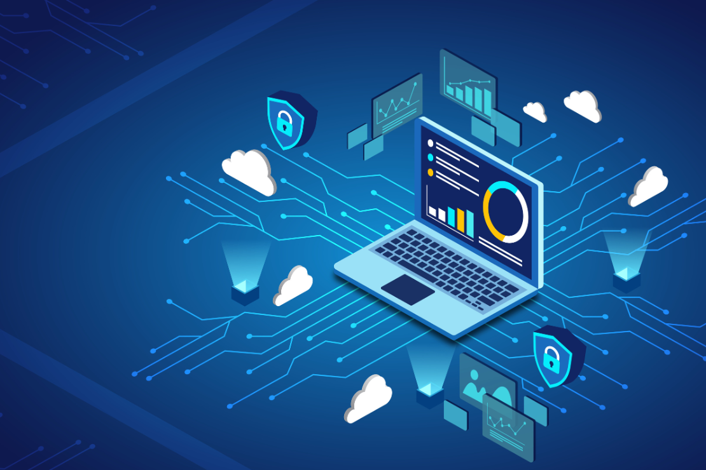

# IAS NOTES | Tagaro, Ven Angel C. | 3BSIT-1

## INTRODUCTION (Cybersecurity)

### What is Cybersecurity?

It is the practice of protecting systems, networks , and programs from digital attacks. These cyberattacks are usually aimed at accessing, changing, destroying sensitive informations, extorting money from users through ransomware, or interrupting normal business processes.

> **Fun Fact about Cybersecurity:** Cybersecurity was originally run by the military.

### Code Idea: CIA Triad

ALmost everything in cybersecurity boils down to three main goals, as the **CIA Triad**

- **Confidentiality:** Keeping secrets secret (e.g., passwords, medical records, company data).
- **Integrity:** Making sure datas remain accurate and not easily tampered by anyone.
- **Availability:** Making sure systems stay up and usable when needed.

## Team Mindsets

### Red Team (Offensive Security):

- Hack systems before malicious threat actors do.
- Simulate real-world cyberattacks and attempt to breach an organization's defenses to identify vulnerabilities.

### Blue Team (Defensive Security):

- Path security gaps before adversaries find and exploit them.
- Monitor network traffic for suspicious activity and implement firewalls.

### Purple Team (Collaborative):

- Basically fuses both Red and Blue efforts to ensure offensive findings directly improve defensive tools.

### Three Pillars of Cybersecurity:

- **People:** Crucial for strong cybersecurity.
- **Processes:** Define security procedures and responses.
- **Technology:** Provides tools to protect systems.

> **All three pillars are essential for effective defense.**

### Key Security Concepts

- **Assets:** Anything of value to the organization that needs protecting.
  - **Tangible Assets:** Physical objects you can touch (servers, laptops, networking equipment, physical buildings).
  - **Intangible Assets:** Non-physical property of value (customer data, intellectual property, company reputation).
- **Vulnerabilities:** A flaw or weakness in system security procedures, design, implementation, or internal controls.
  - **Technical Vulnerabilities:** Flaws in software, hardware, or network configurations (unpatched software, misconfigured firewalls, zero-day bugs).
  - **Human Vulnerabilities:** Weaknesses introduced by user behavior or lack of awareness (untrained employees, weak passwords, social engineering susceptibility).
- **Threats:** Any circumstance or event with the potential to adversely impact an asset.
  - **Intentional Threats:** Deliberate malicious actions targeting digital infrastructure (hackers, malicious corporate insiders, ransomware gangs).
  - **Accidental & Natural:** Unintentional human errors or unpredictable environmental events (employee deleting databases, power outages, natural disasters).
- **Risk (The Calculation):** The probability of a threat exploiting a vulnerability and the resulting business impact.
  - **Equation:** Risk = Threat x Vulnerability x Impact

### Vulnerability Scanning vs. Penetration Testing

- **Vulnerability Scanning:**
  - A systematic review of security weaknesses in an information system.
  - Uses automated tools to check for known vulnerability signatures.
  - Automated reports must be manually validated by a tester.
- **Penetration Testing:**
  - A simulated cyberattack against a computer system to check for exploitable vulnerabilities by actively exploiting them.
  - Tests the IT staff's response to perceived security incidents and their knowledge of security policies.
- **Penetration Testing Life Cycle (6 Stages):**
  1. **Recon ("Discovering the Target"):** Passive information gathering (Whois, sublist3r, Google Dorks, Web Tech).
  2. **Enumeration/Scanning ("Probing the Defenses"):** Active information gathering (Port scan, VA scan, host discovery).
  3. **Gaining Access ("Breaking In"):** Exploiting vulnerabilities to gain an initial foothold.
  4. **Maintaining Access ("Securing Our Foothold"):** Creating backdoors, infecting executables, and establishing C2 connections.
  5. **Covering Tracks ("Erasing Our Footprints"):** Deleting logs, history commands, and artifacts.
  6. **Reporting ("Documentation and Communication"):** Delivering test findings and suggested countermeasures to management.

### Threat Frameworks & Methodologies

- **Threat Framework:** A standardized, structured methodology used across cybersecurity to handle threat lifecycles (Analyze, Categorize, Mitigate).

- **The MITRE ATT&CK® Framework:**
  - Stands for **Adversarial Tactics, Techniques, and Common Knowledge**.
  - A globally accessible knowledge base of adversary tactics and techniques based on real-world observations.
  - Shifts focus from what we are protecting (CIA Triad) to how attackers actually operate.
  - **Tactics (The "Why"):** The attacker's short-term tactical goal (e.g., Initial Access, Persistence, Privilege Escalation).
  - **Techniques (The "How"):** The specific method used to achieve the tactic (e.g., Phishing, Token Manipulation).

---

## Encryption Fundmentals (Cryptography)

### The Principles of Cryptography

- **Encryption:** Secures data by converting it into unreadable ciphertext.
- **Authentication:** Verifies the identity of users or systems.
- **Integrity:** Ensures data remains unaltered during transmission.
- **Non-repudiation:** Prevents parties from denying actions or messages.

### Hash Functions, Ciphers, and Key Exchange Algorithms

- **Hash Functions:**
  - **Input Data:** The original, readable message or data before it undergoes the hashing process.
  - **One-Way Algorithm:** A mathematical function that processes the input and converts it into a unique, fixed-size output, making it computationally impossible to reverse.
  - **Unique Digest:** The resulting fixed-length hash value where a minor change in the input results in a completely different hash digest.
- **Ciphers (Symmetric vs Asymmetric):**
  - **Symmetric Encryption:** Uses a single, shared secret session key to both encrypt and decrypt information, making it fast and efficient for large volumes of data.
  - **Asymmetric Encryption:** Uses two different session keys—a public key for encryption and a private key for decryption.
- **Key Exchange Algorithms:**
  - **Diffie-Hellman:** Allows two parties to choose private keys, calculate and share public keys, and compute a shared secret key without transmitting the secret over an insecure circuit.
  - **Asymmetric Algorithms:**
    - **RSA:** The gold standard for web traffic and key exchanges, relying on prime factorization.
    - **DSA:** A federal standard strictly for digital signature verification.
    - **ECDSA:** An elliptic curve variant offering equivalent security with smaller keys and faster speeds for mobile devices.
- **Symmetric Cryptographic Algorithms:**
  - **DES & 3DES:** Legacy standards using a 56-bit key or applying the algorithm three times for 168 bits, built on the Feistel cipher architecture.
  - **IDEA:** A robust block cipher operating on 64-bit plaintext blocks with a 128-bit key, resistant to differential cryptanalysis.
  - **AES:** The modern gold standard supporting 128, 192, and 256-bit keys for secure wireless, database, and web traffic.
  - **RC Suite:** Versatile ciphers like RC4 (stream cipher) and RC6 (block cipher) known for high operational speed.

### Transport Encryption vs. End-to-End Encryption

- **Transport Encryption:** Encrypts data point-to-point only while traveling between your device and the server, allowing the provider to hold keys and perform server-side indexing.
- **End-to-End Encryption:** Encrypts data on the sender's device so that only the final recipient can decrypt it, ensuring no third party or intermediate provider has access.

### Certificate Authorities and X.509 Certificates

- **Certificate Authority (CA):** Issues certificates, validates holder identity, and uses its digital signature to guarantee authenticity.
- **Digital Certificates (X.509):** Verify the identity of the holder and provide the holder's public key to facilitate encryption and digital signatures.

---

## Cloud & Virtualization (Fundamentals)

### Hypervisors: Definition and Role

- **Hypervisor:** A specialized software, firmware, or hardware layer that abstracts and manages underlying physical hardware to create and run virtualized operating systems (virtual machines).
- **Type 1: Native (Bare-Metal):** Installed directly onto the physical hardware without requiring an underlying operating system, providing high performance and direct resource management.
- **Type 2: Hosted:** Installed as an application on top of an existing host operating system, which manages hardware interactions on behalf of the virtual machines.

### Cloud Storage: Definition and Functions

- **Overview:** Provides scalable space on cloud-based servers where files are stored for free or via a subscription and accessed through web browsers or applications.
- **File Synchronization:** Automatically sends and syncs data to and from all of your different devices using a single account.
- **Content Delivery Networks (CDN):** Consists of a globally distributed network of servers that caches content close to the user to minimize latency, delay, and download times.

### Cloud Deployment Models

- **Public Cloud:** The most common and inexpensive cloud model where service providers make shared infrastructure and resources available to end users over the public internet.
- **Private Cloud:** Cloud architecture that operates in an exclusive internal environment where the organization is fully responsible for design, implementation, and management.
- **Hybrid Cloud:** Combines private and public models, allowing organizations to develop certain internal resources while outsourcing or leveraging public cloud services under strict governance and rules.
- **Community Cloud:** Resources and costs are shared among several organizations with common security, compliance, or functional needs, though connecting networks means inheriting external security risks.

### Major Functions and Benefits of a Cloud Access Security Broker (CASB)

- **Overview:** A security policy enforcement point placed between cloud service consumers and providers to ensure proper device connectivity and security standards.
- **Visibility and Monitoring:** Provides deep visibility into how users utilize cloud services and monitors resource activity.
- **Core Benefits:**
  - Enables single sign-on authentication.
  - Enforces access controls and authorizations.
  - Scans for malware and rogue devices.
  - Reduces the risk of data theft.

- > **Examples:** Solutions like Skyhigh Security, Forcepoint, Blue Coat, and CloudLock.
